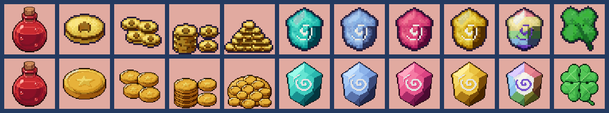
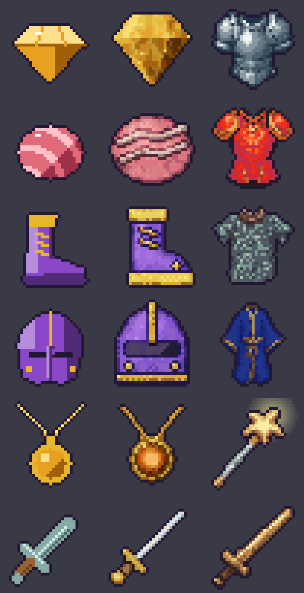

# Pixel style: Storyleaf's look, without Retro Diffusion

What makes a sprite look like the rest of Storyleaf, measured, so art drawn in code can be held to it. The
reference is every sprite Retro Diffusion (RD) drew that the game ships; the goal is new sprites nobody can
tell apart from them, made for free and rebuilt from source. Read it before drawing a sprite in code; read
[sprite-acceptance.md](sprite-acceptance.md) too for anything worn by a hero. Add what you learn, with the
date: this is meant to get stricter as we go.

## The tools

- `tools/pixel_style.py`: the measurements. `calibrate` measures the reference and writes each criterion's
  accepted band to `tools/pixel_style.json`; `check [--kind icon|creature|scenery] <png>...` scores sprites
  (exit 1 on a fail); `compare` scores the RD icons against the code-drawn ones, the criteria's own test.
- `tools/pixel_style.py check --kind item <png>`: the clean item icons' rules (2026-10-26, *Item icons*
  below), house rules from RD's Potion.
- `tools/clean_icon_art.py` and `tools/coin_art.py`: item icons drawn in the clean look, at 64 pixels.
- `tools/pixel_kit.py`: a renderer for the look. A sprite is shapes (ellipses, polygons, thick strokes) in
  the sprite's own pixels, back to front, each of a `Material`; the kit lights, textures and quantises them
  into pixel art with the outline, rim light, contact shadows and highlights described below.
  `--demo out.png` redraws six code-drawn icons with it: as drawn now, the kit, and an RD icon, side by side,
  each with its score.

## The look, in words

These are the rules the numbers measure. A sprite that keeps them looks like Storyleaf.

1. **Hard pixels.** No anti-aliasing, no partial transparency, except a light effect (a magic staff's glow).
   Shrinking is done offline, each pixel the colour covering most of it, never by the game.
2. **One light, from the top left.** Every form is rounded by it: a lit rim on its top-left edge, a core
   shadow along its bottom right, and a contact shadow under anything lying on top of it.
3. **Ramps, not fills.** Each material is a ramp of shades: 3 to 5 on a 32-pixel icon, more on a bigger
   sprite (RD's icons have a median of 4 per ramp, its creatures 9). Shadows go deeper, more saturated and
   turn away from yellow round the colour wheel (a red's toward crimson, a blue's toward violet); highlights
   go paler and turn toward yellow (hue-shifting). Greys (steel, stone) get a cool tint in shadow and a warm
   one in the light, never dead grey.
4. **Texture everywhere.** No interior pixel sits in a field of its own colour: surfaces carry small
   clusters of near-duplicate shades (one to three pixels), and the clusters follow the light rather than
   scattering as noise. Dithering only to soften a step between two shades, never as a checkerboard field:
   on a sprite this small it reads as noise.
5. **Light from one side, not from the outline in.** Shading that darkens every edge evenly and brightens
   the middle ("pillow shading") flattens a form; RD's shade a form on its side away from the light.
6. **Clean lines.** Along a slope the steps of the outline grow or shrink steadily (1, 1, 2, 2, 3), never
   jump about (1, 3, 1, 3: "jaggies"); no lone pixel stuck out of an edge, no doubled corner.
7. **Outlines.** Item icons (the grained finish; drawn anew, see *Item icons: the clean look* below): one dark
   outline all round, the house colour `#231834` (`item_art.OUTLINE`).
   On something darker than it (a navy lash), the kit deepens it to half the light of what it rounds, so it
   still reads as the edge. Creatures, scenery and buildings: a broken, tinted outline, a deep shade of
   what it rounds and close to its colour, never near-black: a green tree's is dark green, a red roof's
   dark red (about 0.6 to 0.85 of the light inside it, `outline_rel`; the kit's `outline="tinted"` takes
   it from the shape's own ramp), lighter or gone where the light hits.
8. **A few highlights.** A speck or two of the lightest shade on what's glossy (gems, eyes), not a
   wash. Polished metal and cut stone get RD's glint: a small cross of near-white (`pixel_kit.GLINT`,
   `#f1f5f3`, one white for every metal) where the form faces the light, on its upper left, ringed by the
   lightest shade, and a speck more on another bulge; helms the same as the armour they go with.
9. **Size and placement.** Icons fill 80% or more of their 32 × 32 tile and sit in its middle (armour; a
   weapon sits on the bottom edge with room above for its glow). Creatures and scenery at their kind's size
   (`art/assets.json`: monsters 40 or 64, props 32 to 96, buildings 96, tiles 32).
10. **Light in broad areas, a palette kept small (buildings).** RD lights a house as a few big areas: a lit
    front, the side going back well into shadow, a dark band under the eaves, the lit roof plane bright at
    each tile's top, shadows turned toward blue and lights toward yellow. Detail sits on top of that, never
    instead of it (`light_masses`), and the whole house holds about 18 to 35 colours (`colour_density`
    capped as well as floored): every face its own seven shades made ours a hundred colours of grain.

## Item icons: the clean look (2026-10-26)

**This replaces the rules above for item icons.** Playtesting 2026-10-26: "A lot of item icons feel too clunky.
I think we went too far with making the visuals look more natural [...] But now items like the coins don't look
nice. Look at the potion items we created with retro diffusion, those look nice. The borders shouldn't look so
thick and dark either." The reference is RD's Potion (`item_potion`, `rd_pro__fantasy` at 64 pixels; the Ether
and the Hi-Potions are recolours of it), the only item RD drew at 64. Measured against it, the grained finish
(`pixel_kit.restyle` on `item_art.py`'s designs, 32 pixels, the house outline) went wrong in four ways:

| | RD's Potion | grained icons (old) | clean icons (new) |
|---|---|---|---|
| canvas | 64 | 32 | 64 |
| outline's hue against what it rounds (`outline_hue`) | 6° | 35° to 138° (the house violet round gold or green) | 6° to 11° |
| outline pixels with a dark pixel right inside (`outline_double`) | 0.29 | up to 0.67 | 0.06 to 0.39 |
| just inside the line on the lit side, over the lit tone (`rim_lit`) | 0.70 | | 0.62 to 0.74 |
| colours per 100 pixels (`colour_density`) | 1.95 | 2.3 to 10 | 0.5 to 1.6 |
| mean size of a patch of one colour (`cluster_size`) | 3.6 | 1.6 to 3.2 | 4 to 43 |

1. **The border read thick because it was two pixels, not because it was dark.** The Potion's outline is
   near-black (value 0.08), darker than our house violet. But it is one pixel at 64, half the width on screen
   of one pixel at 32, and nothing dark lies inside it. Ours was a pixel at 32 with the kit's darkened ring
   inside it (`rim="shape"`), so it read as a frame two to four screen pixels thick.
2. **The outline was the wrong colour.** The Potion's is a deep crimson round red glass and a deep brown
   round the cork. The house violet round a gold coin or a green leaf is a different hue, and it reads as a
   drawn border, not as the thing's own edge in shadow.
3. **Grain is noise at this size.** The texture clusters, the twin ramp and the dither made every surface
   speckled (colour density 2 to 5 times the Potion's). The Potion's glass is smooth: broad bands of one
   colour each, three or four steps from shadow to light, a few clean highlights.
4. **The light was frontal and its ends compressed.** It was tuned on RD's armour (lit in its middle,
   darkening toward every edge, the lightest shade well short of white), so coins came out as dull brass.
   The Potion is lit from the top left (0.51 on `light_top_left`), from a crimson a third of its base up to a
   pale pink.

So an item icon now has these rules (`pixel_style.py check --kind item`, `ITEM_RULES`; house rules, as the
reference is one sprite, each set from the Potion with a margin and checked against what it must fail):

| rule | limit | hard | why |
|---|---|---|---|
| `canvas` | 64 | yes | finer pixels: a one-pixel outline is thin, a highlight can be a streak |
| `native` | ≥ 0.3 | yes | drawn at 64, not blown up from 32 (blown up: 0; flat designs at most 0.24; the Potion 0.5) |
| `fill` | ≥ 0.78 | yes | as before |
| `semi_alpha` | 0 | yes | hard pixels |
| `outline_hue` | ≤ 30° | yes | the outline a deep shade of what it rounds |
| `outline_double` | ≤ 0.45 | yes | one pixel, no dark ring inside it |
| `colour_density` | ≤ 2.6 | yes | smooth ramps, no grain (now a cap, not a floor) |
| `rim_lit` | ≤ 0.85 | yes | a mid-tone rim inside the line on the lit side, not a hairline (the Potion 0.70) |
| `outline_rel` | ≤ 0.32 | | still deep enough to read as the edge (the Potion 0.13) |
| `line_value` | ≤ 0.15 | | the line near-black in its hue (the Potion 0.08) |
| `cluster_size` | ≥ 3 | | light in bands, not specks |
| `orphans` | ≤ 0.2 | | no salt and pepper |
| `checker` | ≤ 0.05 | | no dither fields |
| `value_range` | ≥ 0.45 | | deep shadows to pale lights |
| `shades_per_ramp` | ≥ 4 | | a form shaded in steps, not a flat design's three tones |
| `light_top_left` | ≥ 0.1 | | one light, from the top left |
| `hue_shift` | ≥ 3° | | shadows away from yellow, lights toward it, as before |
| `jaggies` | ≤ 0.08 | | clean lines, as before |
| `kinks` | ≤ 0.04 | | no outline stepping a pixel in and straight back out (the Potion 0; two shapes meeting make a few) |

**What they have to do themselves** (`pixel_style.py compare`, first lines): pass the Potion and every clean
icon, and fail the grained icons (338 of 338 fail), the grained icons blown up to 64 (60 of 60; on
`outline_double`, `outline_rel`, `jaggies`), the flat designs blown up to 64 with a tinted outline added
(34 of 34; on `native`), and the grained finish rendered at 64 (10 of 10; on `outline_hue`, and on grain for
half). Before `native` and `shades_per_ramp` were added, 12 of those 34 flat designs passed: the rules let
"basic forms" through, which the user doesn't want either.

**How to draw one** (`pixel_kit.Sprite.clean()`, `render(outline="deep")`, materials with `texture=0,
variety=0, wide=True`; `tools/clean_icon_art.py` and `tools/coin_art.py` are the examples):

- **Lit from the top left** (`ITEM_LIGHT`): the upper left of a form near the top of its ramp, the lower right
  near its foot. A face looking straight out sits a little over the middle.
- **Long ramps, smooth:** 6 or 7 shades a material from a third of the base to a pale tint (`wide`), no grain,
  no twin ramp, no dither. Flat planes (a gem's facets, `tone`) still brighten a little toward the light across
  them, so they shade in two or three bands as the Potion's glass does.
- **A core shadow, not a dark ring:** only the edges turned from the light (below, right) step darker
  (`rim="core"`).
- **A mid-tone rim on the lit side:** just inside the outline at the top left, the material at no more than
  two fifths up its ramp, never its lightest shade, as the Potion keeps a band of mid-tone glass there. Going
  straight from the line to a highlight, the edge reads as a hairline (`rim_lit`).
- **One outline, a deep shade of what it rounds** (`deep_shade`: 0.35 of the value of the material's darkest
  shade, its hue kept, a touch richer; the line's value 0.07 to 0.10, the Potion's 0.08): a gold coin's is
  dark umber, a teal gem's deep teal.
- **Lines inside are softer than the outline:** where one object lies over another (`Sprite.part()`: a coin on a
  coin, one leaf on the next) a line in the darkest shade of the one beneath, not the outline's colour. In the
  outline's colour a heap of coins read as cracked rock. The parts of one object (a coin's rim, field and star)
  get no line at all: the light parts them.
- **Shapes on the pixel grid** (`Sprite.snap`, on in `clean()`): an ellipse a whole number of pixels across
  and down, its edges on pixel boundaries, so its halves round alike; a disc's edge seen from the front one
  shape with straight sides (`Sprite.capsule`), not two ellipses laid one over the other, which pinch where
  they meet; a stack's coins a whole number of pixels apart.
- **Shine is drawn, not computed:** a streak along the edge facing the light (a coin's rim, a gem's table) and a
  speck or two, in a pale tint of the material (`relief=0`), as the Potion's highlight and bubbles are.
- **Detail at the new size:** a coin's raised rim, its sunken field with the rim's shadow on its upper left, a
  star struck in it; a gem's six crown facets round its table. Fewer, bigger forms than RD's armour carries,
  but each one modelled.
- **Read it as a whole:** a heap is a mound with coins strewn on it at odd angles, not rows of coins (rows read
  as bricks).

**Where it stands (2026-10-26):** redrawn so far: the four coin piles (`coin_art.py`), the five Seal Stones and
the lucky clover (`clean_icon_art.py`, which `item_art.py` now skips). Every other code-drawn item icon (338) is
still the grained finish and fails these rules. To bring the rest across, family by family (fix a family's
helper, as before): draw it in `clean_icon_art.py` at 64, check it with `--kind item`, look at it beside the
Potion at the size the bag shows it (`--sheet`), and in the game (`tools/screenshots.txt`: `clean_icons`,
`clean_coins`). Families with palette swaps (`derive` in art/assets.json: the rings, many capes) need their
swaps redone on the new drawing. The rules for weapons and armour (RD's drawings shrunk to 32 by
`weapon_art.py` and `armour_art.py`) are unchanged so far: they are RD's own, and the `icon` bands still judge
them.

## The target: Pixel Heroes (2026-10-25)

The user's reference for where the art should go is *Pixel Heroes: Tales of Emond* (HaoPlay): its heroes,
its app icon and its logo ("I want to get closer to Pixel Heroes"). Its art was measured from the user's
App Store screenshots (1206 × 2622, the hero lineup slide), each sprite sampled on its own pixel grid (an art
pixel is about 3.5 screen pixels), with five of its sprites against ours. Screenshots are compressed, so
read colour counts as rough; outlines and darkness hold up.

| | outline light, median | edge pixels darker than 0.25 | inside darker than 0.2 | saturation, median |
|---|---|---|---|---|
| Pixel Heroes (5 heroes and creatures) | 0.15 to 0.25 | 50 to 66% | 28 to 44% | 0.46 to 0.53 |
| our heroes' walk sheets (front) | 0.05 to 0.25 | 39 to 97% | 26 to 39% | 0.57 to 0.81 |
| our creatures, bosses and townsfolk (65) | 0.12 to 0.67 | 32 of 65 meet both outline marks | 0 to 12% on the pale ones | – |

(Light is luma, 0.3 R + 0.59 G + 0.11 B.) What it shows:

- **The same scale as ours.** Its heroes stand about 36 to 44 art pixels tall, ours 27 to 39 in a 48-pixel
  frame. Nothing needs redrawing bigger.
- **Our heroes already have its outline;** many of our creatures don't. Pixel Heroes outlines everything,
  creatures too, in a dark line (deep brown, navy, forest, never pure black), and draws dark lines inside as
  well, between hair and face, cloth and body, one limb and the next: a third of its pixels are that dark.
  33 of our 65 creatures, bosses and townsfolk have a pale, tinted outline instead (the Comet Hare 0.67, the
  Wisp 0.66, the frost bear 0.64, the Prism Drake 0.60, the Big Bad Wolf 0.44), and next to its heroes they
  look washed out. That tinted outline is what rule 7 above asks of creatures; for characters and creatures
  the Pixel Heroes line replaces it (sprite-acceptance.md, *Characters and creatures*).
- **Chibi, bright and clean.** Big heads (about two to two and a half heads tall), big eyes with a light
  catchlight, saturated colour (a median around 0.5), shading in a few clean steps with crisp highlights,
  and a silhouette you can tell from its neighbours' at a glance (ears, hats, wings, weapons).
- **The white sticker outline is for marketing only.** On its store slides every sprite has a white rim two
  or three art pixels wide over a soft background; in the game they don't.

Scenery, buildings and item icons keep the rules above: Pixel Heroes' own trees and grass are soft and
outlined lightly, so the characters stand out against them.

## What the craft says (sources)

Read 2026-10-23, from search results (the network policy blocked fetching the pages themselves, so these
are their summaries, checked against each other). What each taught, and where it went:

- **Pillow shading and banding** are the two mistakes the craft names first: shading from the outline
  inward instead of from a light, and parallel bands of shades that follow the outline and reveal the
  sprite's pixel grid. A 2025 TU Delft thesis on detecting pixel-art mistakes automatically ("Pixel Fixer",
  [repository.tudelft.nl](https://repository.tudelft.nl/record/uuid:b3c91b18-d9e8-48e0-91ce-8afafd2439d8))
  measures them from the image, as `pixel_style.py` does: its `pillow` metric (reported).
- **Jaggies:** along a line or curve the run lengths should change steadily; an odd run breaks the slope
  ([Pixel Parmesan, anti-aliasing fundamentals](https://pixelparmesan.com/anti-aliasing-fundamentals-for-pixel-artists),
  [saint11's tutorials](https://saint11.art/blog/pixel-art-tutorials/)). Became the `jaggies` criterion,
  and the kit's cleanup of notches and spurs after shrinking.
- **Hue shifting:** shadows move round the wheel away from the light's colour, highlights toward it,
  rather than only darkening ([pixnote, shading](https://pixnote.net/en/learn/shading),
  [Slynyrd's Pixelblog](https://www.slynyrd.com/pixelblog-catalogue)). The kit turns shadows away from
  yellow (it had leaned every ramp toward blue, which turned a blue's shadow *toward* yellow: `hue_shift`
  negative on every blue item).
- **Outlines and selout:** a coloured outline, a deep shade of what it rounds, reads softer than black;
  lighter where the light hits ([Lospec, outlines part 2](https://lospec.com/articles/pixel-art-outlines-part-2-using-color)).
  Our icons keep one house outline (the game's choice for the bag); creatures and scenery are measured on
  tinted ones (`outline_sat`, `outline_value`).
- **Dithering restraint:** on a small sprite, dither only a narrow band between two shades; a field of it
  is noise ([pixnote, dithering](https://pixnote.net/en/learn/dithering),
  [Pixel Parmesan, dithering](https://pixelparmesan.com/dithering-for-pixel-artists)). The kit dithers only
  near a step; `checker` reports any field of it.
- **Shades per ramp:** a 16 to 32 pixel sprite needs 3 to 5 shades a material; more muddies it. RD's icons
  have a median of 4; ours had 6 (see the armour study below).
- **Scenery:** foliage in clusters of light and shade, never per-leaf noise; a top-down object lit from one
  side with its own shadow on the ground; a repeated prop varied by shape, not only by colour
  ([Slynyrd, top-down objects](https://www.slynyrd.com/blog/2019/9/18/pixelblog-21-top-down-objects)).

## RD's armour, studied (2026-10-23)

RD's 57 armour icons are the closest reference for everything worn, so the hats, gloves, boots and capes
drawn in code were measured against them (medians):

| | light from the top left | value range | colours / 100 px | highlight share | shades per ramp | hue shift | pass |
|---|---|---|---|---|---|---|---|
| RD's armour (57) | 0.12 | 0.59 | 3.8 | 0.06 | 4 | 9.1° | 84% |
| ours, worn pieces (143) | 0.31 | 0.61 | 4.2 | 0.10 | 6 | 12.3° | 84% |

What was changed to get there: the light comes more from the front (`pixel_kit.LIGHT`), so a form is lit
across its face and turns dark only at its edges, as RD's are; the ramps' ends are compressed (deep, rich
shadows, a pale top never white) and pivot lower, as RD's colours sit darker than a flat design's;
shadows turn away from yellow; a set piece takes its armour's colour. What's still different: our
light falls off more from the top left (0.31 against 0.12), which comes from the designs' own shading,
not the kit (softening the kit's light moved it by 0.01); and our ramps carry 6 shades to RD's 4.

`tools/pixel_style.py check` measures 15 criteria, and reports two more. Each one's band is the reference's 5th to 95th
percentile for its kind (icon, creature, scenery), recalibrated from the shipped art; a few are fixed
house rules, and three have house-rule floors under them (`pixel_style.FLOORS`, marked *floor*), set where
about 85% or more of RD's own sprites of that kind meet them. **A sprite passes with every hard criterion
and 80% of the soft ones.**

| criterion | what it measures | kind | icon | creature | scenery |
|---|---|---|---|---|---|
| `colour_density` | colours per 100 opaque pixels (ramps and texture) | hard, min | ≥ 2.4 | ≥ 1.7 | ≥ 0.6 |
| `flat` | share of inner pixels whose 8 neighbours are all their colour | hard, max | ≤ 0.02 | ≤ 0.14 | ≤ 0.14 |
| `outline_dark` | share of edge pixels darker than the inside | hard, min | ≥ 0.98 | ≥ 0.18 | – |
| `fill` | the sprite's longer side over the canvas (icons only) | hard, rule | ≥ 0.78 | – | – |
| `cluster_size` | mean size of same-colour patches inside: noise is 1, flat fills are big | soft | 1.4 – 3.3 | 1.6 – 4.8 | 1.3 – 4.9 |
| `outline_sat`, `outline_value` | the outline's colour: tinted, deep | soft | the house colour | 0.18+ / 0.11 – 0.57 | – |
| `orphans` | single pixels unlike all four neighbours | soft, max | ≤ 0.56 | ≤ 0.40 | ≤ 0.61 |
| `shades_per_ramp` | brightness levels in each ramp (colours chained by hue, greys one ramp) | soft, min | ≥ 3 *floor* | ≥ 5 *floor* | ≥ 4 *floor* |
| `hue_shift` | degrees a ramp's dark third sits further from yellow than its light third | soft, min | ≥ 0° *floor* | ≥ 6.1° | ≥ 2° *floor* |
| `value_range` | luma from the 5th to the 95th percentile | soft, min | ≥ 0.35 | ≥ 0.37 | ≥ 0.19 |
| `light_top_left` | correlation of brightness with nearness to the top left | soft, min | ≥ 0 *floor* | ≥ 0 *floor* | ≥ −0.05 *floor* |
| `highlight_share` | share of inner pixels far brighter than the median | soft | ≤ 0.29 | ≤ 0.18 | ≤ 0.25 |
| `semi_alpha` | partly transparent pixels (light effects only) | soft, max | 0 | 0 | 0 |
| `jaggies` | runs along one slope of the outline 2 or more longer, or shorter, than both neighbours | soft, max | ≤ 0.08 | ≤ 0.12 | ≤ 0.14 |
| `outline_rel` | the outline's light over the inside's within 2 pixels (median): deep, not black | hard (scenery, buildings), soft, min | ≥ 0.27 | ≥ 0.49 | ≥ 0.61 |
| `light_masses` | share of the inside's spread of light left after a 5 × 5 blur (buildings only) | soft, min | – | – | – |
| `straight_edges` | share of the silhouette's top, bottom and side edges in straight runs of 6 or more (buildings only) | hard, max | – | – | – |
| `grid_lines` | share of the inside on straight seams 7 or more long, darker than both neighbours across (buildings only) | soft, max | – | – | – |
| `form_relief` | median slope of the light after a 9 × 9 blur: light modelling the big forms (buildings only) | hard, min | – | – | – |
| `pillow` | how much more the inside's light follows the distance in from the edge than the light | reported | – | – | – |
| `checker` | share of the inside in 2 × 2 checkerboards of two colours (dithering) | reported | – | – | – |

`pillow` and `checker` measure two classic mistakes the sources below warn about, but neither catches
anything yet: RD's icons have a median `pillow` of 0.10 and `checker` of 0.009, ours 0.09 and 0.008, and
the flat designs score lower still on both (−0.33, 0). So they describe and don't judge; promote one to a
criterion once a sprite fails it by eye.

The numbers above are from the 2026-10-23 calibration; `tools/pixel_style.json` holds the current ones.

### What the criteria have to do themselves

The criteria are only trusted while they tell the two kinds of art apart. Rerun `compare` after any change
to a metric or band:

- **The reference passes:** at least 80% of RD's own sprites of each kind (the bands are 5th to 95th
  percentiles, so a few of RD's own always fall outside one). 2026-10-23, with the floors, `jaggies` and
  `outline_rel`: icons 87% (122 / 140), scenery 82% (109 / 133), creatures 78% (51 / 65), buildings 69%
  (20 / 29, below).
- **The flat look fails:** `tools/item_art.py`'s designs, unfinished, pass at most 10%. 2026-10-23: 7%
  (22 / 322), failing on `cluster_size` (91%), `flat` (90%), `colour_density` (82%) and `shades_per_ramp`
  (79%). The same items as shipped, finished by the kit, pass 84% (289 / 343).

### Review by eye: what the numbers can't see

Numbers are necessary, not sufficient: a sprite can pass them all and still look off (2026-10-23: the kit's
first texture passed as salt-and-pepper noise, which is what added `cluster_size`). Before a sprite ships:

- Look at it **beside RD sprites of its kind**, at 1× and at 4× (`pixel_kit.py --demo` makes that sheet for
  icons; a contact sheet for the rest), and **in the game** (a CI screenshot: `tools/screenshots.txt`).
- **It reads at 1×:** you can tell what it is at the size it's drawn, from its silhouette alone.
- **Its detail matches its neighbours':** RD invents material detail (chain links, overlapping plates,
  scales, folds, seams). A sprite with less looks cheaper beside them, however well it's shaded.
- **The texture follows the form:** clusters run along the light, never as noise or a checkerboard.
- **Colours belong to the game:** the material's colour matches its family elsewhere (an armour's icon and
  its walk sheet: `wear_art.MATERIAL`).
- **It reads as what it is, first:** a prop's familiar shape comes before its story. The Rat King's junk
  throne heaped from crates read as no throne; drawn as a throne (a high arched back, arms, a cushioned seat
  on legs) with junk in its making, it does.
- **Nothing about it looks like a stand:** two matching flat shapes either side of a foot (roots, legs)
  read as a stand it's set on. Vary them: lengths, angles, one in front.
- **It looks like its neighbours on the map:** a new tree beside RD's trees, a house beside RD's houses.
  Different in kind is fine; different in make (a thick dark outline, a pole of one colour, flat feet)
  stands out.

When the eye catches something the numbers passed, write it down under *Learned* below and add or tighten
a criterion so it can't pass again. That is how the criteria get stricter.

### Trees

Checked as `tools/scenery_art.py` draws them (it fails the run): **its trunk runs up into its crown**,
no sky in the trunk's middle column between the ground and the top of the tree (`tree_shape`; the willow's
and the lilac's showed 2 and 3 pixels of it), and **its crown is centred over its trunk**, within
1.5 pixels, as RD's own tree is (`CROWN_OFF_MAX`; the candy trees' hung 2.5 left). Exceptions, each for a
reason: the dark tree leans (`LEANS`), the frost tree is bare (`BARE`). And by eye, against RD's `tree`:

- **A short trunk under a low crown:** about a quarter of the tree's height shows (RD's 14 pixels of 56),
  never half of it as a pole.
- **Bark, not one brown:** a few warm browns (`#422711` to `#a58153` on RD's) in streaks down it, lit on
  its left, in shadow on its right, and the crown's shadow across its top.
- **Roots as fingers:** four or so, of different lengths, leaving the trunk well up it and sloping down
  and out, the nearer ones shorter and steeper; never two flat feet, one either side, like a stand.

### Small sprites (critters, about 10 to 17 pixels)

Too small for the kit's finish or the bands: most of a sprite this size is edge, so rims and ramps
darken nearly all of it. Each part keeps its colour; only the silhouette is lit (its top and left a shade
lighter, its bottom and right a shade darker and turned from yellow), a shade under a part of another
colour lying on it, and an outline in a deep shade of each part (`tools/critter_art.py`). Reviewed by eye
beside the old drawing: brighter or the same, never muddier.

The butterflies (2026-10-25) were the last drawn in Swift: 7 × 5, flat, shown three times as big, so their
pixels were three times everyone else's. They're drawn in `critter_art.py` at the critters' scale (15 × 12
with the outline, a pixel to a pixel), as a butterfly reads from above: forewings with a deeper tip and a
pale spot, a notch at the side, hindwings a shade deeper tapering to the tail, antennae a pixel each, and a
flap of three frames (open, half, closed). Their lemon yellow turned green in shade (a hue just past
yellow turns away from it the green way), so the yellow is a touch warmer. They pass the creature bands.

### Snow

Snow is RD's own colours (`scenery_art.SNOW`, from its `snow_tree`): white, pale blue-green, blue-grey,
outlined in a deep blue-grey. A near-white base on a ramp turns grey, so it's drawn in a key colour and laid
on these after (`snow_palette`). Snow lies in soft clumps, never in a strip along an edge.

On a snow land anything without snow on it reads dark (playtesting 2026-10-24: "these small dark trees
don't look so nice"): the land's palette pushes every dark shade toward deep blue, and on pale snow a
plant's stems and outline come out a navy splat. Give a cold land's plants snow of their own, in RD's
whites as its snow pine has them (`scenery_art.snow_conifer`, `snow_sapling`), or a recolour that lifts
their dark shades first (`frost_fern`: a rule for the darks, `maxValue` 0.45, before the rest).

### Buildings

RD's buildings have a band set of their own (`--kind building`, the 29 RD drew): a 96-pixel house holds
fewer colours to its size than a bush, and a third of RD's own failed the general scenery bands. Their
`outline_dark` is soft, not hard: RD draws buildings with a broken, tinted outline that a lit roof edge
goes without; but `outline_rel` is hard, so what outline there is stays a deep shade of the wall or roof.
Three more rules are theirs alone (playtesting 2026-10-23, "more and better shading and lighting, like
RD's"): `colour_density` is capped as well as floored (0.54 to 1.4 colours per 100 pixels, the cap a
house rule, `pixel_style.CEILINGS`, over all of RD's but its fence), `light_masses` at least 0.55 (a
floor met by 86% of RD's), and `outline_rel` at least 0.55. `tools/building_art.py` meets them with
quiet textures (`TEXTURE`), a stronger hue shift (`SHIFT`), faces lit by the way they turn (the side
going back 0.4 darker, the lit roof plane 0.14 lighter, the eave's shadow 0.6) and a palette cut to
about 1.1 colours per 100 pixels (`pixel_kit.limit_palette`, which merges the closest pair into the
commoner over and over, so a lit window or a flower keeps its colour). RD's buildings pass their own bands
69% (20 / 29), under the 80% the criteria aim for: in a sample of 29 every new band cuts one or two of
RD's own. Widen one before adding another.

**Drawn by hand, not ruled (2026-10-24, the user: our new buildings were "a bit too squared"; "look at the
retro diffusion visuals and try to recreate that").** Side by side with RD's, ours were boxes: walls
and roofs on the ruler, every face's blocks, planks and tiles on a grid, tall walls under thin roofs, a deep
side wall going back, and a hard footing line on nothing. RD's:

- **Bend.** No edge of a house is straight: walls lean and bulge a little, rooflines sag, eaves curl. Two
  criteria measure it, met by RD's own and failed by our boxes: `straight_edges` (RD's median 0.17, ours
  were 0.41; hard, at most 0.40, RD's 90th percentile, `pixel_style.CAPS`) and `grid_lines` (RD's
  0.014, ours 0.039; soft, at most 0.033). They cost two of RD's own a pass (now 18 / 29): its puppet
  theatre and shop front are drawn as boxes too. `building_art.by_hand` draws a building with `Build.bend`:
  every edge cut every couple of pixels and moved by one smooth field of offsets (about 1.2 pixels, the
  same wherever two faces share an edge, so they still meet).
- **Big rounded stuff.** Stones are lumps 4 to 8 pixels long, each lit on its upper left and dark on its
  lower right, corners worn into the joints, every other one a pixel up so no joint runs across the face
  (`rubble`); shingles are rounded tongues that curl at their foot (`shingles`, 8 × 5). A fine even
  grid of blocks reads as squared paper.
- **Squat, under a big roof.** Short walls (20 to 23 pixels on a house), the roof about as tall as the
  wall and overhanging it by 5 or 6, a narrow side wall (`depth` 0.5 to 0.7 of the old one), and a
  building about as tall as it's wide: RD's are 0.8 to 1.4 times as tall as wide (median 1.0); ours spread
  to 0.6 with props off to the sides, which shrank the house itself when `fit` scaled it. Keep props close.
- **On its own ground.** RD stands a house on a rounded patch of grass, earth or snow a little wider than
  its walls, with tufts round its edge, a few stones and a path to the door (`grounds`).

- **Not one size.** RD drew every building on one 96-pixel canvas, so a guild hall came out the size of a
  cottage (the user, 2026-10-24: "the guilds need to be larger and more grandiose; I feel like we're stuck
  to one size of block"). A grand building is drawn on a bigger canvas (`building_art.grand(160)`: the same
  96-pixel frame's drawing scaled up to fill it, its stones and shingles still at the sprite's pixels, its
  palette cap grown with its area) and given the room on the map (maps.json building `size`, its footprint
  in cells, `MapDef.Building.footprint`; a house's is 3 × 2, the guild halls' 5 × 3). Give it more than
  more of the same: towers, a second storey, a porch or a wing, a crest, a forecourt.

**Modelled, not flat (2026-10-24, the user: the new landmarks "still look a bit too flat and should look a
bit more three-dimensional, like the retro diffusion sprites").** Measured over RD's 29 and our 28, RD's
buildings aren't lit left to right as a whole (the mean difference across a row is about 0): what sets
them apart is light that models every big form. A tower is shaded round, a doorway is deep, a band has
its shadow under it, a roof darkens toward its eave. Ours lit each face in one tone, so the slope of the
light once a blur has taken the detail out (`form_relief`, 9 × 9) was RD's median 0.018 and ours 0.014.
It's hard for buildings, at least 0.016 (`pixel_style.FLOORS`): seven in ten of RD's reach it, and at
RD's 15th percentile (0.014) our flat ones passed. Fifteen of the other 25 drawn in code fall short
(most of the houses and shops, the tents, Glimmerbough's houses, the Wildfolk Lodge and the gem
workshop): give one these when it's next touched. What lifts it (`tools/building_art.py`):

- **Round what's round.** A tower, a turret or a cone is shaded across as a drum (`curve` on `surface` and
  `box`: lit a little left of its middle, deep at its right edge, a touch dark at its left), not a flat
  face with a darker strip beside it.
- **A shadow under everything that stands out.** A band, a cornice, a parapet or a string course is a
  `ledge`: its top lit going back, its front rounded, and its shadow on the wall under it. Painted on
  flat, it reads as a stripe.
- **Openings set back.** A window or a door has a reveal: its frame's shadow along the top and right
  inside (`window(deep=True)`, `door(deep=True)`), and a sill casts one on the wall.
- **A shadow on the ground.** A building casts one down and to the right of its foot, longer the taller
  it is (`ground_shadow`), away from the light at the top left.
- **Depth inside.** A basin or a pool shows its far inner wall in shadow before its water.
- **A round building is a drum, not a box.** Its foot and top curve with it (an ellipse a third as tall as
  it's wide, `TILT`), its wall shaded round, a ring round it with its top seen from above, and a dome
  seated on its top edge (`drum`, `ring`, `dome`). A dome on a flat-fronted box, with a wing beside it,
  looked wrong (the first Star Observatory, 2026-10-24); of four drawn instead, the slender tower was
  picked.
- **Made things stay straight.** The hand-drawn bend is for walls, roofs and stone. A telescope, a pole
  or a tube bent with them looks wavy (2026-10-24): draw it `straight=True` (`poly`, `stroke`), shaded
  round as a cylinder.

The acorn cottage (Glimmerbough) was redrawn so (2026-10-25, the user: "pretty bad and looks too 2
dimensional"): flat fills in a brick-like grid, no ground under it, `form_relief` 0.010. Now its nut is an
egg shaded round (`curve`), its staves bowing with it, its foot curving into a patch of grass, and its cap
a dome of `shingles` with a rolled rim that throws a curved shadow on the nut: 0.020, every band passed.
Its round windows are lamplit amber held at one tone: a pale yellow glass on its ramp came out tan, and
the palette cut (`limit_palette`) merged it into the cap.

The three landmarks (`emerald_spire`, `star_observatory`, `moonwell`) went from 0.015, 0.015 and 0.019 to
0.017, 0.023 (redrawn as a drum) and 0.022 with these. `fit` measured a drawing on the 96-pixel frame, so one taller than it
(the spire) was cut off and measured short; one that reaches the frame's edge is now measured again on a
canvas with room all round.

The five drawn so (`lake_shrine`, `warrior_guild`, `wildfolk_lodge`, `bell_tower`, `gem_workshop`) score
0.13 to 0.22 on `straight_edges` and under 0.02 on `grid_lines`. The houses and shops drawn before
(2026-10-23) predate the two criteria and most fail `straight_edges` (0.1 to 0.74): redraw one with
`by_hand` when it's next touched.

### The ship

The ship moored at each harbor (`tools/prop_art.py`, `draw_ship`) is a prop, but a made thing as big as a
grand building (202 × 328), so it's held to the building bands, `form_relief` and all, as well as the
scenery ones (2026-10-25: "update the ship visual with our new acceptance criteria"). Drawn in flat
three-tone fills with the items' near-black outline, it failed seven: `colour_density` 0.10, `flat` 0.34,
`cluster_size` 14.9, `shades_per_ramp` 2, `outline_rel` 0.31, `form_relief` 0.013 and its see-through
foam. Its build stays in 3D (the hull, deck, sails and rigging in the game's own points, projected as
`WorldMap.project` does); now each point keeps its part, its surface's normal and its place on the
surface, and the parts go through `pixel_kit` as the buildings' faces do:

- **Lit by its normals,** under the buildings' light (top left and in front) turned into the ship's axes,
  so its forms model themselves: the hull rounds out from the waterline and turns in to the rail, the
  sail billows and creases toward its corners, the mast and yard are round, the deck turns as it rises
  to the bow, the stern's face leans back into the light.
- **Wood as RD draws it:** long strakes, clinker-built (each lit along its top and shaded down to its
  lap), a wale standing out with its shadow under it, deck boards each weathered its own tone, end joints
  far apart (a wall's planks stacked their joints up like bricks).
- **Something on its deck:** two barrels and a crate, each lit round, and the sails' shadow across the
  deck ahead of the mast.
- **A rig that reads:** the jib well forward on its forestay with sky between it and the square sail,
  the stays drawn behind whatever is nearer.
- **The kit's finish:** a hue-shifted ramp of seven shades per material, the light snapped to the ramp's
  steps with each step's edge broken in soft clusters (left between two shades, the kit dithered the sail's
  slow billow into a checkerboard), a tinted outline, and the palette capped at 0.9 colours per 100 pixels.
  The rigging is hemp, a pixel wide, and the foam opaque specks.

It passes both: the building bands with `form_relief` 0.016, `straight_edges` 0.14, `grid_lines` 0.01
(soft 93%: its outline sits a touch light, `outline_value` 0.36), the scenery bands 100%.

## Restyle: how every item icon is finished

(The grained finish, which every code-drawn item icon still has. New and redrawn ones follow *Item icons: the
clean look* above.)

`tools/item_art.py` designs each item in flat three-tone fills (shapes, colours, details) and
`pixel_kit.restyle` finishes it: each region of colour becomes a material on a hue-shifted ramp, the
silhouette loses its square corners (never its notches or thin lines), the whole is lit from the top left
as one form with each region swelling a little on it, the drawing's own light and dark are kept as detail
(drawn dark lines count double), openings drawn in the outline colour become the inside of the thing in
the item's own colour (darkest at the back under the brim, the lower inner wall a few steps lighter where
the light comes in, its lip lightest; no dither), shiny things go smooth and glossy, a small drawing is scaled up to fill its tile from
4×, and sparkles and glows are kept as drawn. Items that are palette swaps of one (`derive` in
art/assets.json) are swapped on the flat drawing first, where their hue windows were tuned, and finished
the same way. Per-item options live in `item_art.RESTYLE` (smooth paper: less texture).

**Material presets** (`pixel_kit.PRESETS`) bring the detail RD invents and a design doesn't describe: a
pattern of light and shade at the sprite's own pixels, laid on the item's main (biggest) region, with the
finish that goes with it. `plate`: two or three overlapping plates to a piece, lit along their top edges
and shadowed under the next, rivets at their ends, a hard shine. `chain`: rings with dark holes, rows
offset. `scales`: offset rows, each lit on top and shadowed along its round foot. `cloth`: long soft folds
and a faint weave. `leather`: grain and a seam stitched two pixels in. `wood`: grain along its length.
`stone`: cracks and flecks. `fur`: short combed strands. `crystal`: facets, each its own tone, the ridges
lit. `metal`: polished, one hard streak. `item_art.preset_for` picks one per item: set hats by their kind
(plate helms, mail coifs, cloth hats and hoods), gauntlets and set boots plate, gloves and boots leather,
capes cloth, whips leather (scales for a dragon's, crocodile's or snake's), materials by name
(`MATERIAL_PRESETS`).

**Colour from the set.** A hat, gloves or boots that belong to an armour (`item_art.set_armour`) take
its colour from that armour's RD icon (`pixel_kit.dominant_colour`: the median colour of its commonest
hue), so a set reads as one set in the bag; every other region is deepened a little (`_deepen`), as RD's
colours sit lower and richer than a flat design's.

Families share their shapes, so fix a family's helper, not its items: `boot`, `glove`, `cape` and
`hat_piece` (helm, wizard's hat, coif, hood) in tools/item_art.py, drawn with curves (a calf and heel, a
rounded toe, fingers of different lengths with shadow between them, a domed helm with cheek guards, a hat
with its tip bent over, a hood with a soft peak), never boxes. Whips (`whip_line`) hang from the hand:
the handle up and to the right from the pommel, the lash out of its tip, over the top and down the right
in a loose arc, its end trailing off thin along the bottom; never coiled.

## Making a sprite in code

1. Describe it with `pixel_kit.Sprite`: shapes back to front, one `Material` per surface (base colour,
   `texture`, `gloss`; `profile="facet"` or flat planes with a `tone` for cut stone). Give it the detail RD
   would: seams, rivets, straps, folds, as their own shapes.
2. Render and score: `python3 tools/pixel_style.py check --kind icon <png>`.
3. Review by eye as above.
4. Keep the description in a tool (like `tools/prop_art.py` keeps its drawings), so a rerun rebuilds it.

## Where it stands (2026-10-23)

- **Every item icon drawn in code is finished by the kit** (322 of them, and the 21 palette swaps of
  them), most with a material preset: 84% pass (289 / 343), against 8% as designed; RD's own icons pass
  88%. Most of the rest fail on `cluster_size`, `hue_shift` (pale colours near yellow, whose shift has
  nowhere to go) or `jaggies`.
- **Monsters are all RD's** (checked 2026-10-23): 63 of the 124 drawn by RD, the other 61 palette swaps of
  them. Nothing to redraw there; the criteria's `creature` bands guard any added in code later.

- The kit's first six icons (`pixel_kit.py --demo`: amber, agate, the amethyst boots and helm, the amber
  amulet, the alloy shortsword) all pass; as drawn now by `item_art.py`, one of them does. Beside RD's they
  read as the same game but plainer: less designed material detail, and RD's metals have more contrast.
- **Done 2026-10-23:** material presets; the three loose criteria tightened (`shades_per_ramp`,
  `hue_shift`, `light_top_left`, measured afresh: see *Learned*); `jaggies` added, `pillow` and `checker`
  reported; the kit tuned on RD's armour (above); whips redrawn hanging, as held.
- **UI icons (2026-10-23):** finished by the kit as the items are: 17 of 20 pass (2 did as drawn); three
  stay flat (`ui_icon_art.KEEP_FLAT`), as the finish ran their small parts together at button size.
  **2026-10-24: not pixel art any more,** drawn as light like the skill icons (playtesting: "can we use the
  same style from the skill visuals for icons in the UI?").
- **Skill icons (2026-10-23): not pixel art.** Finished by the kit they passed 34 of 41, but read as
  objects, not as the spells they cast (playtesting: "more like their animations, with flares and
  glows"). `tools/skill_art.py` now draws each as light (glows, flares, sparks, trails in its element's
  colours) on a dark backdrop at 128 pixels, shown smoothed; these criteria don't apply to them.
- **Buildings (2026-10-23):** 20 drawn by `tools/building_art.py` (homes, shops, and buildings for the
  deserts, the steppe and Starfall Isle), all passing the building bands.
- **Scenery (2026-10-23):** the 21 trees and bushes that were palette swaps of RD's `tree` and
  `berry_bush` are drawn in code by `tools/scenery_art.py`, a species each; all 21 pass the scenery
  criteria. Lit from lower down than the icons (`Sprite.light`), edges darkened only where they turn
  from the light (`rim="lower"`), no seams between clusters, and a crown laid as clusters of leaves on a
  jittered grid (`puffs`), each lit on its own with a paler patch toward its top left. Beside RD's own
  `tree` they read as the same game but softer, with less contrast in the leaves.
- **Whips:** the shape and finish were picked by eye (2026-10-23); a three-pixel braided lash fails
  `cluster_size` and `orphans` by nature, so not every whip passes.
- **Next, in order:**
  1. Ramps of 4 to 5 shades on icons (RD's 4, ours 6), and less of the designs' own top-left falloff.
  2. Presets on more than the main region (a gauntlet's plate *and* its leather cuff), and per-region
     choice in the designs.
  3. A criterion for designed detail (how much of the inside is a deliberate line or edge, not texture),
     calibrated on RD, so a sprite with less detail than its neighbours fails by number, not only by eye.
  4. More scenery through the kit: the rest of the recoloured families (`crystal` ×6, `mushroom`,
     `giant_flower`, `gift_box`, the lollipops recoloured from a beach umbrella, three houses).
  5. Animation: walk cycles stay RD's for now (`sprite-acceptance.md`).

## Learned

- **2026-10-26 (shapes):** "Some shapes have a bit of weird sides because some pixels don't line up or are a
  bit out of place, making the shape of a smaller coin for example not the right shape." A small coin's side
  stepped 3, 3, 4, 4, 3, 4, 4 pixels in: its face and its edge were two ellipses at fractional positions, the
  union pinched where one ended and the other began, and an ellipse off the grid rounds differently on each
  side. The `jaggies` rule never saw it (it reads only the top and left and only big jumps). Now shapes snap
  to the grid, a coin's edge is one capsule, and `kinks` counts the wobble: 0.04 to 0.14 before, 0 to 0.03
  after, the Potion 0.
- **2026-10-26 (outline weight):** "Are the outlines a bit too thin now?" Measured against the Potion: the
  same one-pixel line, a little paler (0.10 to 0.15 against 0.08), but the real difference was just inside
  it. On the lit side the Potion's glass is a mid tone (0.70 of its lit tone) for a pixel before it brightens,
  so its line reads about one and a half pixels firm; ours went from the line straight to the lightest
  shade (0.93 to 1), a hairline. Thick and dark (the grained finish) and thin (the first clean icons) are
  both about that band, not the line: a near-black ring there is too heavy, the highlight too light, the
  material's own mid tone right. Now a rule (`rim_lit`), with the line deepened to 0.35 of the darkest shade.
- **2026-10-26 (item icons, the clean look):** Measure the reference the user points at before trusting the
  criteria: the `icon` bands failed RD's Potion on five counts (colour density, flatness, the outline's
  depth) and passed the coins the user disliked, because they were calibrated on RD's 32-pixel armour and
  weapons. A border reads thick from its width and what lies inside it, not from how dark it is. Lines inside
  a sprite in the outline's colour turn a heap into cracked rock. A rule that only fails the old finish on
  size proves nothing: test the old look blown up, and the flat designs given the new outline.

- **2026-10-25 (the seasonal app icons, `tools/season_icon_art.py`):** the first round regraded RD's scenery
  by brightness percentile onto each season's ramp, scattered snow, lights and flowers as single pixels, ran
  snow along every top edge, and drew the hats as flat fills with a rim all round. The user: "they don't
  really look good". Held to these rules instead: RD's scenery has only a few colours a class (one to nine),
  so swap each for the one of the same rank on a hue-shifted ramp, which keeps its clusters and light exactly;
  its dark pixels a deep shade of what they round; snow on the lit colour of the leaves' clusters (RD's
  `SNOW`), never per pixel; hats and props drawn with `pixel_kit` (lit, textured, outlined), each hat's band
  on the head's widest row (sprite-acceptance.md, *Head pieces*); and nothing in the corners iOS rounds off.
  Then (the user): "the outline around the hero is not cut correctly", "the witch hat is too straight and the
  bunny ears should be lower". A hand-drawn polygon can't follow a pixel outline: half of it was recoloured as
  scenery. The hero is cut by flooding the background in through everything but dark pixels, up to his own
  outline, and his outline is the dark within 2 pixels of him (`hero_mask`). A witch's hat bends: hollow sides
  and a tip hooked over, drawn low enough that the hook shows in the frame. Hair above a brim is cleared.
  Then: "the mask cuts part of the hair", "the bunny ears should just be the ears, not the band", "the moon
  looks like it has 2 eyes". A flood held back only by dark outlines runs straight through a lock too thin
  for the band (the flick out to the left, the deep red hair behind it): the hair's own oranges and reds,
  like the gold, are never background, and only the biggest piece is the hero. Ears grow out of the hair:
  over its top three rows, behind the rest, short enough to show whole. A full moon with two craters is a
  face; a crescent isn't. Each icon has a night, made as the app icon's dark one is.
  Then: "the Santa hat should sit a bit lower", "the bunny ears should sit lower and come from the front of the
  head", "the mask lets some green of the grass through between the legs", "in dark mode the hats should be
  more lit". Ears half hidden behind the hair read as growing from behind the head: they stand on it, in
  front, with a contact shadow on the hair round their feet. The polygon spans the gap between the legs, so
  the flood can't reach it: it's seeded from the bottom edge too, and below the tunic's hem green is grass.
  At night what he wears is lit as his face is, a little brighter than his hair.
  Then: "don't cut parts of the boots and sword", "the hat bases look too oval, it should look more
  natural", "the ears a bit taller, clipping them at the top is allowed", "a bit of grass at the right hand".
  The band 5 pixels inside the polygon was eroded from the icon's edges too, so the flood ran into the boots
  where the legs run off the bottom (erode from the polygon only); the boots are dark all through, so below
  the hem the dark inside him is his. A brim is an arch (high over the brow, drooping at the sides, a tip
  flicked up, thicker in front), a fur band a curve with tufted edges no wider than the head; an ellipse
  reads as a stiff oval.
  Then: "the witch hat can be a bit taller", "the bunny ears are too slim and stiff, the top should hang
  forward", "the Santa hat's body looks too bulky". An ear is one tapering curve (`sweep`), narrow at its
  foot and widest below the bend, its tip falling forward and out; a folded flap drawn as a shape of its own
  read as a white block. The witch's crown may run off the top so long as its hook comes back into frame.
  Then: "the witch and Santa hat should have a bit more shadow, so it's clearer where the curve sits".
  pixel_kit's dome rounds a shape only near its edge, and under its near-frontal light a big shape is one
  flat colour in the middle. Cloth hats curve all the way over: each run across the shape a half cylinder
  (`rounded`: a cone or cap side to side, a brim or band top to bottom), smoothed along it so a row a pixel
  wider doesn't light as a ridge.
- **2026-10-25 (the logo, `tools/logo_art.py`):** "the DO feel proportionally smaller than the rest of the
  wordmark". Luckiest Guy draws its O and D short (the O 146 pixels to the R's and N's 165), and each letter
  stood on its tipped bounding box's lowest corner, so a tipped one rode high. Every capital is now sized to
  the H's height, a round one 3% over (`ROUND`, `OVERSHOOT`: round shapes look small at the same height), and
  centred on the line before its lift.
- **2026-10-25 (the tinted app icons, `app_icon_art.tint`):** the user, from a Home Screen in iOS's Clear
  look: "the clear and tinted app icons should have a bit more contrast, now it's washed out beside other app
  icons". Stretching the whole picture's greys evenly left it in the middle greys (median 0.2, most of it a
  busy scene); the system's own icons are a light figure on a dark field. The hero (cut on his own outline)
  is stretched to the full range from his daylight colours, the scene pushed down to a dim backdrop with only
  its small lights (and a season's moon) kept bright: a pale patch of snow or blossom kept bright read as noise.
- **2026-10-25 (the ship):** `form_relief` is light per pixel, so a sprite twice a house's size needs
  as much change across areas twice as wide: the ship's deck and hull, lit by their normals alone, were
  flat at the 9 × 9 scale (0.010) and held it at 0.015. What lifted it: boards and strakes each a tone of
  their own and lapped, a wale with its shadow, creases in the sail and its edges curling into shade,
  things on deck. Two that didn't: a camber across the deck (the light has almost nothing across the ship)
  and the sails' cast shadow (light from in front throws shadows behind things, mostly out of sight).
  And build a rig as it would stand, and as it reads: the jib set into the square sail's belly ran its edge
  down the middle of the sail's star, and set just behind it, it came out from under the sail's edge in
  the same cream and read as one sail cut by the other (the user). It's set well forward on its stay now,
  sky between the two, the stay drawn, and ropes hidden behind what's nearer.

- **2026-10-24 (flat buildings):** The landmarks passed every band, by hand and grand, and still looked
  flat beside RD's. Side by side, RD's forms are modelled: towers round, ledges with shadows under them,
  deep doorways, a shadow on the ground. It isn't an overall light-to-dark across the building (RD's is
  about 0, ours more): it's light changing at the scale of the forms, which a 9 × 9 blur keeps and the
  material's detail doesn't. `form_relief` (hard, at least 0.016) now catches it; see *Buildings*.

- **2026-10-24 (squared buildings):** Five buildings passed every band and still looked wrong beside
  RD's: boxes on the ruler with gridded faces, tall walls under thin roofs, props spread wide. What made
  the difference, in order: edges bent by a smooth field (`Build.bend`), big rounded stones and shingles
  instead of a fine grid, a squat body under a big overhanging roof with a narrow side wall, a patch of
  ground under it, and props kept close so the house fills its frame. `straight_edges` (hard) and
  `grid_lines` now catch the first two; see *Buildings*.

- **2026-10-23 (roots, throne):** Roots drawn as one long flat wedge either side of the trunk read as a
  stand the tree was set on; RD's are separate fingers of different lengths, leaving the trunk well up it.
  A willow's trunk that stopped under its crown left sky between them, hidden from the sides by its
  strands and plain from the front: `tree_shape` now fails a tree for it. The Rat King's throne, crates
  heaped into a seat, read as no throne: a familiar shape first, its story in the details.

- **2026-10-23 (trunks):** A trunk drawn as one stroke of dark brown was a flat pole, half the tree's
  height, that stood out from the land; and a crown set above where the branches end left a gap of grass
  under it. RD's trunk is short under a low crown, flares into long roots, and is bark: a few warm browns
  in streaks (`#422711` to `#a58153`), lit down its left. `scenery_art.trunk` draws it so, and `lower`
  sets the crowns down over it.

- **2026-10-23 (critters):** At 10 to 15 pixels the kit's finish turns a sprite muddy: most of it is edge,
  so its rim shadows and ramps darken nearly every pixel (a white bunny came out grey, a chick olive).
  `tools/critter_art.py` keeps each part's colour and lights only the silhouette: its top and left a
  shade lighter, its bottom and right a shade darker and turned from yellow, a shade under a part of
  another colour lying on it, and an outline in a deep shade of each part.

- **2026-10-23 (frost tree):** The bare winter tree drawn as kit strokes looked out of place among RD's
  snow scenery: limbs of one width like pipes, a thin strip of snow, icicles. RD's snow is soft clumps in
  its own colours (`scenery_art.SNOW`, from its `snow_tree`); a near-white base on a ramp turns grey, so
  snow is drawn in a key blue and laid on RD's colours after. Twigs drawn by the kit get an outline each
  and run together into a dark mass at 64 pixels: they're single pixel lines (`pixel_lines`), as RD's.

- **2026-10-23 (outlines):** The tinted outline at 0.6 of each shape's darkest shade came out near-black
  (`outline_rel` 0.37 on our trees and houses, against RD's 0.6 to 0.85), the stark black line round
  everything we drew. It's now the shape's own ramp at the shade of the body within two pixels, about
  0.74 of its light (0.9 on the lit top and left), a touch richer: our trees 0.81, houses 0.77. Taken
  from each pixel it touched, it doubled the colour count; from the ramp a material's outline holds a
  handful. Taken from the darkened rim alone, pale bushes still came out too dark.
- **2026-10-23 (buildings):** Seven shades for every face, a second ramp to flick between and texture on
  every pixel gave our houses 115 to 180 colours against RD's 18 to 35, and light that lived in grain
  instead of areas. Fewer, broader: quieter textures, one ramp, the palette merged to about RD's size,
  and the faces' light set by how they turn.

- **2026-10-23 (buildings):** Patterns laid in the screen's rows put a receding roof's tiles at the wrong
  angle; each face now carries its own axes (`building_art.surface(axes=...)`: along its eave, down its
  slope or wall), so tiles run along the eave and their seams down the slope. Evenly lit faces looked
  flat: walls now lie in the eave's shadow at the top and the ground's at the foot, the side going back
  a step darker, a lit corner, the roof's edge thick, its planes lit by the way they face.

- **2026-10-23 (icons):** A design's halves in a colour's mid and light leave the light the commonest, and
  the finish ramps the whole shape from it: an orange arrow came out beige. Draw in the mid and the
  shadow; the finish brings the light. Small parts closer than about three pixels (a paw's toes, three
  dots) run together once rounded and outlined: space them, or keep the drawing flat.

- **2026-10-23 (buildings):** Pale plaster on a ramp turns cold grey (its shadows turned away from yellow),
  as fur did: a wall's colour is drawn a little deeper and warmer (`#ead2a8`, not `#efe4d0`) so its middle
  stays cream. Drawn at a guessed size, the houses filled half their frame beside RD's; each is now scaled
  to fill it, its materials' patterns kept at the sprite's own pixels.

- **2026-10-23 (scenery):** A crown of leaf clusters placed at random came out lopsided; on a jittered grid
  it's full and even. Big clusters on a 32-pixel bush read as a smooth lump: RD's bushes are leafy, so
  bushes use many small clusters (3 pixels across) and trees fewer, bigger ones. Seams between clusters
  read as cracks: RD parts them by shadow alone.

- **2026-10-23 (hue shift):** "Shadows toward blue" is a shortcut that only works for warm colours: on a
  blue it turns the shadow toward cyan and yellow, the wrong way, and every blue item measured a negative
  `hue_shift`. The rule is relative to the light: shadows away from yellow, round the short way.
- **2026-10-23 (outline):** The house outline is no darker than a navy or shadow-violet item, and those
  failed `outline_dark`; it's now deepened to half the light of what it rounds.
- **2026-10-23 (whips):** Four shapes tried; the one picked is the lash arching from the handle's tip over
  the top and down the right, its end flicked along the bottom. A coil read as a rope, an S from a
  diagonal handle as a hook, a closed D loop as a lasso. Its tip trailing off into a few specks was
  liked as it is: thickening it to one line made a heavy foot.
- **2026-10-23 (hoods):** A hood's opening as one flat dark shade read as a black hole: the inside needs
  its own light, darkest under the brim and lighter down the lower inner wall.
- **2026-10-23 (fur):** A hood's fur drawn as a thin even cream ring read as a white border, nothing
  like the fur on the cloak it goes with; a thick tufted one read as overdone. As on the cloak's collar:
  about 3 pixels, a smooth edge, shaded cream, beige and a warm taupe (`item_art.FUR`), a few flecks;
  kept in its drawn colours
  (`restyle(trim=...)`), as re-ramped its shadows turned a cold grey. A trim can outsize the cloth it
  edges, so it's never the region that takes the set's colour.
- **2026-10-23 (coif):** A face painted in a coif's opening read as a skin-coloured stain at icon size;
  the opening is the inside, in shadow, like a hood's.
- **2026-10-23 (restyle):** The outline colour (a deep violet) grouped with a purple hood by hue, so the
  whole hood was shaded as its own opening. The outline colour is now a region of its own.
- **2026-10-23 (glints):** RD's armour has a near-white glint on each plate; our helms had only a
  lightest-shade speck, so beside their armour they looked dull. A plate's lit lower edges can outshine
  its dome, so the main glint is looked for on the upper left.
- **2026-10-23 (restyle):** Colour families group by hue (within 22°): a yellow paw and a yellow-brown grip
  became one region and the paw turned brown. Give parts that must stay apart hues that are apart.

- **2026-10-23 (criteria):** `shades_per_ramp` and `hue_shift` first grouped colours in fixed 30° hue
  bins; a hue-shifted ramp crosses bins by design, so it was split and counted short (RD's own icons scored
  a median of 3 shades, and a shift could never exceed 30°). Ramps are now chained by hue (a gap over 25°
  starts a new one), greys one ramp, shades counted as brightness levels: RD's icons median 4, creatures
  9, the flat designs 2. Fix the measurement before tightening a band on it.
- **2026-10-23 (presets):** A preset must add to the design's own shading, never replace it: replaced, a
  silver ingot lost its lit top and shaded side and went flat.
- **2026-10-23 (presets):** Plate bands every 5 pixels made helms look like hamburgers; RD draws two or
  three overlapping plates to a piece, so the band spacing follows the piece's height.
- **2026-10-23 (ramps):** A base drawn in pure white leaves the ramp nowhere to go but white: the base is
  capped at 0.88 brightness, and a pale colour sits lower on its ramp.

- **2026-10-23:** RD's icons have almost no flat area (median `flat` 0) and small colour patches (median
  cluster 1.9 pixels): the texture is fine-grained, not blotchy. Code-drawn icons fail on exactly that.
- **2026-10-23:** Texture added before shrinking averages away; it has to be added at the sprite's own
  pixels, in 2-pixel clusters (per-pixel noise reads as salt-and-pepper).
- **2026-10-23:** One clean ramp per material looks plastic: RD's surfaces carry near-duplicate colours. A
  second ramp a few degrees round the wheel, picked in 2 × 2 patches, brought the kit up to RD's colour
  density.
- **2026-10-23 (restyle):** Blur-and-threshold rounding fills notches as readily as it cuts corners: a
  glove's fingers merged into a mitten. Rounding may only remove pixels, and a thin line (body neighbours
  on opposite sides) is kept while a one-pixel spur (one neighbour) is cut.
- **2026-10-23 (restyle):** A hood's opening drawn in black came out as a flat black hole; RD shades the
  inside of a hood as a deep shadow of the hood's own colour.
- **2026-10-23 (restyle):** Palette swaps tuned on flat fills miss hue-shifted ramps (shadows lean blue,
  highlights yellow): swap the design, then finish it, never the other way round.
- **2026-10-23 (restyle):** Pale materials need a higher shadow floor, or a pearl's shade drops to navy.
- **2026-10-23:** Cut gems read best as explicit planes, each with its own tone (lit crown on the left, the
  pavilion stepping into shade to the right), not as a dome.
